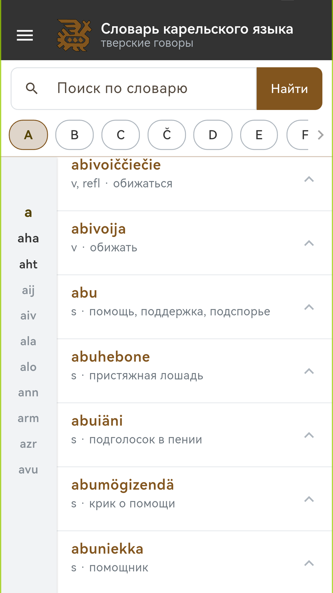
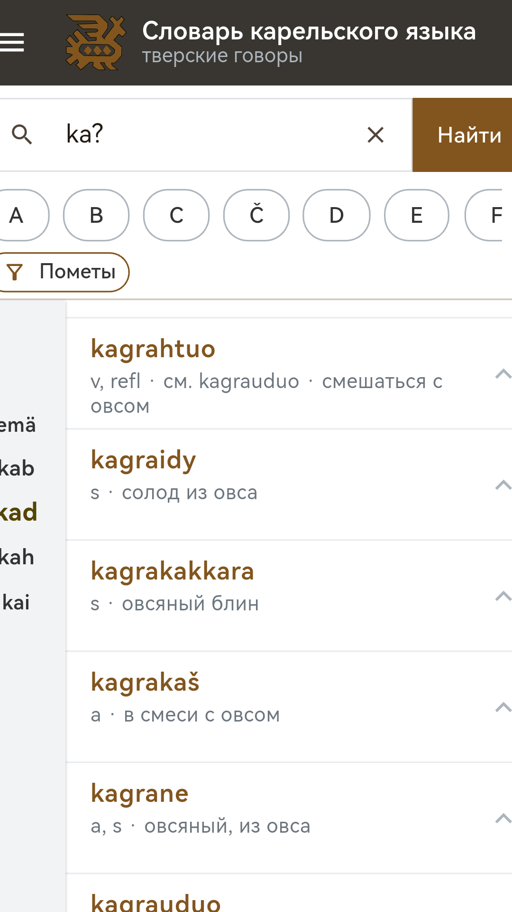
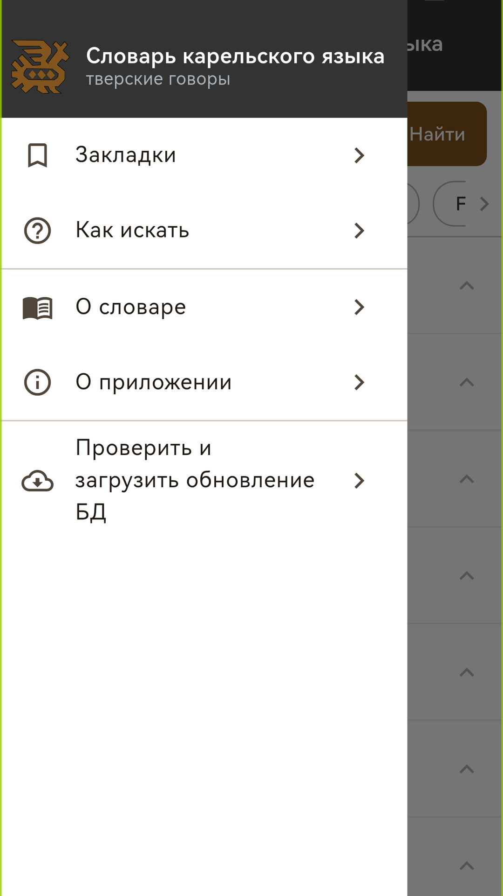

# Словарь карельского языка (тверские говоры)

Офлайн-приложение для Android: электронная версия словаря Александры Васильевны Пунжиной.

  
  
  
  

Алфавитный указатель, поиск, карточка статьи, меню.

## Зачем

«Словарь карельского языка (тверские говоры)» (1994) — основное лексикографическое издание по языку тверских карел. Электронная версия на [сайте проекта](https://punzhina.krc.karelia.ru/) включает авторские правки и дополнения составителя.

Приложение — тот же словарь на телефоне, когда интернета нет или сайт открывать неудобно. Входа и сети для чтения не нужно. Это ограниченный клиент веб-версии: расширенный поиск, онтология и остальные материалы сайта здесь не повторяются. Когда сеть есть, удобнее [полная веб-версия](https://punzhina.krc.karelia.ru/).

## Что внутри

- алфавитный указатель по карельским буквам;
- поиск по заглавному карельскому слову и по русским переводам;
- карточки статей со ссылками «см.» и «от»;
- пометы и закладки;
- работа целиком без интернета; обновление базы — по желанию, из меню.

## Как пользоваться

Откройте букву в указателе или введите запрос в поиск.

- Кириллица ищет **русские переводы** с начала слова: `кош` находит «кошка», «кошелёк». Буква **ё** равна **е**.
- Латиница и карельская орфография ищут **заглавное слово**. Совпадение полное; часть слова задаётся шаблоном: `.` — одна буква, `?` — любое число символов (`boi?` находит `boila`). Диакритику в запросе можно не ставить.
- Если точного карельского слова нет, приложение предложит близкие написания.
- Из карточки переход по «см.» и «от»; назад — системной кнопкой.
- Закладки, справка «Как искать» и пункт «Проверить и загрузить обновление БД» — в меню.

Та же справка по поиску встроена в приложение.

## Скачать

APK: <https://punzhina.krc.karelia.ru/mobile-pack/punzh-dict-latest.apk>

Пилот в магазинах: RuStore и Huawei AppGallery. Правообладатель словаря — [КарНЦ РАН](https://www.krc.karelia.ru/).

## Разработка

Сборка, ветки, seed и тесты — в [`docs/DEVELOPMENT.md`](docs/DEVELOPMENT.md).
