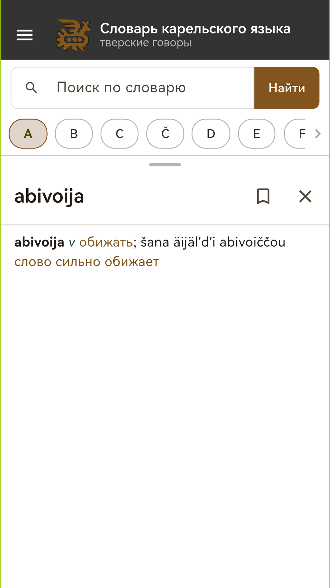

# punzh-dict-mobile

Офлайн-приложение «Словарь карельского языка (тверские говоры)» Пунжиной.

<p>
  
  
  
  
</p>

Данные и сайт — sibling **`../punzh-dict`** (экспорт sqlite, `/mobile-pack/`, Django).  
Семантика клиента: [`docs/DICTIONARY.md`](docs/DICTIONARY.md).  
Ручной регресс: [`docs/MANUAL-REGRESSION.md`](docs/MANUAL-REGRESSION.md).  
Агентам: [`AGENTS.md`](AGENTS.md).  
Контракт пакета: [`../punzh-dict/docs/plans/mobile-pack-contract.md`](../punzh-dict/docs/plans/mobile-pack-contract.md).

Версия приложения — `version: X.Y.Z+N` в `pubspec.yaml`.  
Ветки: **`main`** — store/release (нужен `android/key.properties`); **`dev`** — USB/debug.

```bash
scripts/build_apk.sh           # release → APK + копия в ../punzh-dict/app/downloads/
flutter build appbundle --release   # AAB для RuStore / AppGallery
scripts/publish_downloads.sh   # только выкладка APK в punzh-dict (если уже собран)
scripts/build_apk.sh --debug
scripts/debug_usb.sh           # hot reload на USB (удобнее с ветки dev)
scripts/sync_seed.sh           # export из punzh-dict → assets/dict.sqlite
```

После release APK — **коммит `app/downloads/` в punzh-dict** (см. [`AGENTS.md`](AGENTS.md)).  
Витрина Huawei: [`store/huawei/`](store/huawei/) (тексты, чеклист AGC, иконка/скрины).

## Обновление словаря (пакет данных)

Прод: `https://punzhina.krc.karelia.ru/mobile-pack/manifest.json`  
Публикация пакета — из **punzh-dict**: `scripts/publish_mobile_pack.sh`.

В меню приложения: «Проверить и загрузить обновление БД».

## Seed

`assets/dict.sqlite` в git не коммитится. Для тестов — `test/fixtures/mini.sqlite`.

```bash
# нужен запущенный Django-контейнер в punzh-dict
scripts/sync_seed.sh
```

## Тесты

```bash
flutter test
flutter analyze
```
